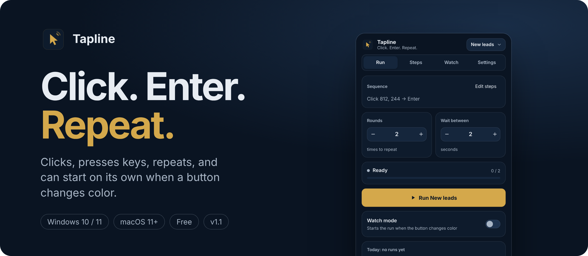

<p align="center">
  
</p>

<p align="center">
  <a href="https://github.com/HanyJr/tapline/releases/latest/download/Tapline-Windows-Setup.exe"></a>
  &nbsp;
  <a href="https://github.com/HanyJr/tapline/releases/latest/download/Tapline-Mac.dmg"></a>
</p>

<p align="center">
  <b>Version 1.1</b> &nbsp;·&nbsp; Free &nbsp;·&nbsp; Windows 10 and 11 &nbsp;·&nbsp; macOS 11 or later &nbsp;·&nbsp; <a href="https://hanyjr.github.io/tapline/">Website</a> &nbsp;·&nbsp; <a href="https://github.com/HanyJr/tapline/releases">All releases</a>
</p>

<br>

## What it does

Tapline runs a short sequence of clicks and key presses, repeats it as many times as you set, and can **start on its own when a button on your screen changes color**. One key starts it, the same key stops it, and <kbd>Esc</kbd> stops everything.

## Features

| | |
|---|---|
| **Watch mode** | Pick a spot and its "new" color. When that spot turns that color, Tapline runs your sequence by itself, then waits for it to go back to normal and a cooldown before it can fire again. |
| **Steps** | Build a sequence: click (left, right or double), press a key with Ctrl / Shift / Alt / Cmd, type text, or wait. Each step has its own pause. |
| **Mouse travel time** | Set how many milliseconds the mouse takes to glide to each spot, or 0 to jump instantly. |
| **Rounds and timing** | Repeat 1 to 999 times, with 0 seconds to 10 minutes between rounds. |
| **Presets** | Save several setups, such as "New leads" and "Refresh queue", and switch in one click. |
| **Your own key** | Start and stop with F1 to F12, with or without Ctrl, Shift or Alt. Works from any window. |
| **Emergency stop** | <kbd>Esc</kbd> stops the run and switches Watch off. Or slam the mouse into any screen corner. |
| **Sound and notification** | Know the moment Watch starts a run. |
| **History** | See today's runs and when the last one happened. |
| **Tray / menu bar** | Close the window and keep Tapline running. Run, watch or quit from the icon. |
| **Open at login** | Ready as soon as you turn on your computer. |
| **Update notices** | Tapline tells you when a new version is out, with a one-click download. |
| **Private** | No account and nothing sent anywhere. The only connection is the update check to GitHub. |

## Install

### Windows
1. Download **Tapline-Windows-Setup.exe** with the button above.
2. Open it. If you see *Windows protected your PC*, press **More info**, then **Run anyway**.
3. Tapline installs for your user only (no admin needed) and appears in the Start menu.

### Mac
1. Download **Tapline-Mac.dmg** with the button above. It runs on Apple Silicon and Intel.
2. Open it and drag **Tapline** into **Applications**.
3. First launch: right-click Tapline, choose **Open**, then **Open** again. On macOS 15 or later, go to *System Settings > Privacy & Security* and press **Open Anyway**.
4. Allow Tapline under *Privacy & Security > Accessibility* so it can click and type.
5. For Watch mode, also allow it under *Privacy & Security > Screen Recording*, then reopen Tapline. This only lets it read the color of the spot you chose.

## How to use

**Run it yourself**
1. Open **Steps** and press **Set spot**, then hold the mouse over the button. It saves after 3 seconds.
2. Add any other steps you need, such as Enter or a wait.
3. On **Run**, set **Rounds** and **Wait between**, then press **Run** or your key (F8 by default).

**Let Watch start it**
1. Make the button show its "new" color.
2. Open **Watch**, press **Set from screen** and hold the mouse on the button for 3 seconds.
3. Press **Start watching**. Keep that spot visible on screen.
4. If it fires too easily or not at all, change **Sensitivity**. Raise **Cooldown** to make it wait longer between runs.

## For developers

Built with [Tauri 2](https://tauri.app) (Rust) and a plain HTML/CSS/JS interface, so the app is small and opens instantly.

```
ui/            App window
src-tauri/     Rust: sequence engine, Watch mode (screen color), hotkeys, tray, settings
docs/          Product website (GitHub Pages)
scripts/       Logo generator
```

Every push to `main` builds the Windows installer and the universal Mac app on GitHub Actions and attaches them to a draft release, including copies named `Tapline-Windows-Setup.exe` and `Tapline-Mac.dmg` that the download links use. To build locally: install Rust and Node 22, then run `npm ci` and `npx tauri build`.

<br>

<p align="center"><sub>Copyright 2026 HanyJr</sub></p>
